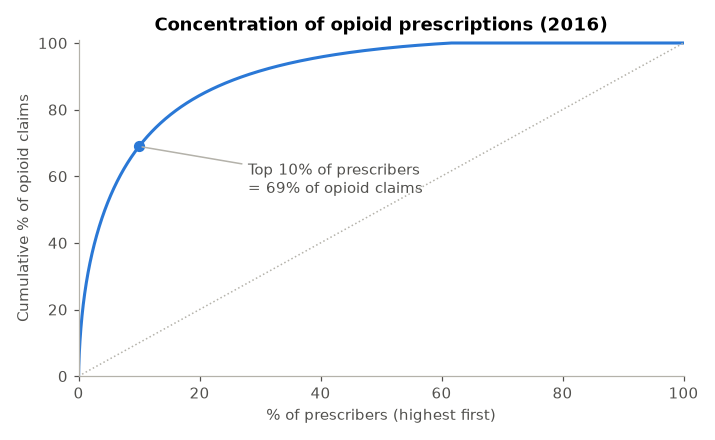
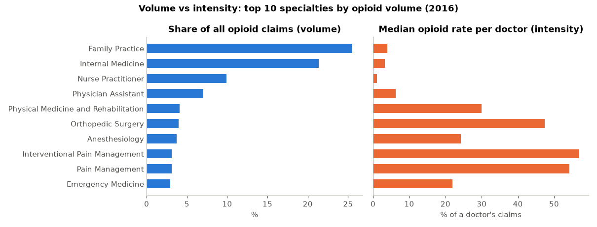
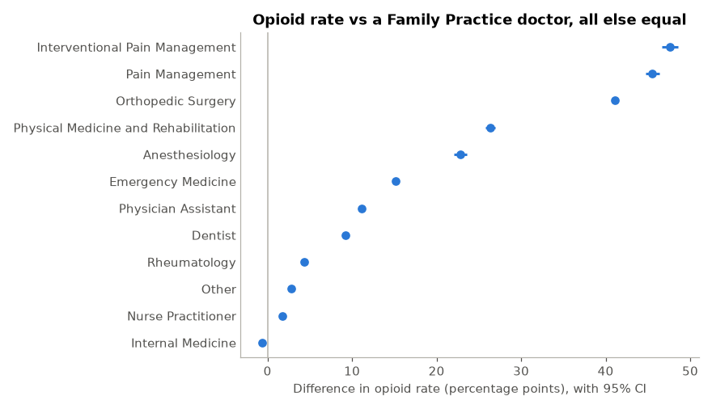
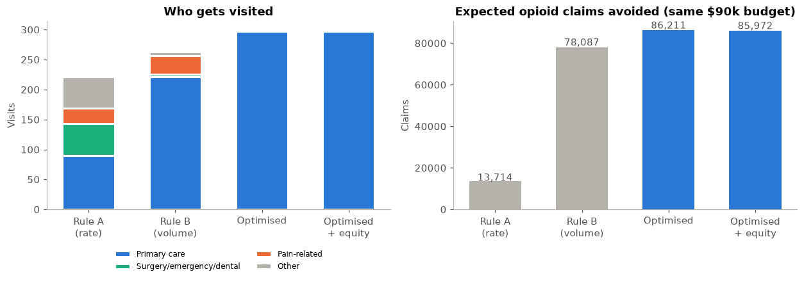

# Opioid Prescribing Patterns & Intervention Targeting

**Statistical analysis and decision optimization on 800,000+ US Medicare prescribers (CMS Part D, 2013–2016)**

A state health department wants to reduce risky opioid prescribing with a limited budget for one-on-one doctor
education visits ("academic detailing"). This project answers four questions:

1. Where is opioid prescribing concentrated?
2. Are the differences between specialties, regions and years real? *(hypothesis tests)*
3. What explains a doctor's opioid prescribing rate? *(explanatory regression)*
4. Which doctors should be visited to get the biggest reduction within budget and staff limits? *(integer optimization with PuLP)*

An LLM step turns the results into a plain-English executive brief and **automatically checks every number it writes**
against the analysis output.

**Tools:** Python, pandas, SciPy, statsmodels, PuLP, matplotlib, Google Gemini API

---

## Key findings

| # | Finding | Evidence |
|---|---|---|
| 1 | **Opioid prescribing is highly concentrated.** The top 10% of prescribers write **69%** of all opioid claims; the top 1% write **25%**. | Pareto analysis, 804,678 prescribers (2016) |
| 2 | **Specialty is the main driver; region matters little.** | Kruskal–Wallis ε² = **0.27** (large) vs chi-square Cramér's V = **0.03** (small) |
| 3 | **Volume ≠ intensity.** Family Practice + Internal Medicine write **47%** of opioid claims but have median rates of only ~3–4%. Pain specialists have median rates above **50%** but write ~3% each. | Descriptive statistics |
| 4 | **Nurse practitioners prescribe opioids at lower rates than primary-care physicians**: median **1.0%** vs **3.6%** (95% CI for the difference: −3.0 to −2.2 points). | Mann–Whitney U, bootstrap CI |
| 5 | **The same doctors reduced their opioid rate** from 2013 to 2016: mean change **−1.40 points** (95% CI −1.43 to −1.38), across 525,852 matched doctors. The aggregate rate fell from **6.45%** to **5.98%**. | Wilcoxon signed-rank (paired) |
| 6 | **Holding practice size and region constant**, pain-management specialists' opioid rate is ~**46–48 points** higher than a Family Practice doctor's; orthopedic surgeons ~**41 points** higher. Model R² = **0.23**. | OLS with robust (HC3) standard errors, VIF < 3.1 |
| 7 | **Optimized targeting beats rules of thumb.** For the same \$90,000 in Tennessee, the PuLP model avoids **10.4%** more opioid claims than "visit the biggest prescribers" and **6.3×** more than "visit the highest-rate prescribers". The advantage holds (+4% to +13%) when the key assumption is varied. | Integer linear programming + sensitivity analysis |
| 8 | **Equity has a measurable, small cost:** requiring 25% of visits in West Tennessee gives up only **0.3%** of impact. | Constrained re-optimization |






---

## Methods

### Hypothesis tests (α = 0.05, with effect sizes)
With hundreds of thousands of doctors, nearly every test is "significant", so every test also reports an **effect size**
to show whether the difference actually matters.

| Question | Test | Why this test |
|---|---|---|
| Do rates differ across the top 10 specialties? | Kruskal–Wallis + ε² | Rates are heavily right-skewed, so a rank-based alternative to ANOVA |
| Do NPs differ from primary-care physicians? | Mann–Whitney U + rank-biserial r + bootstrap CI | Two independent, skewed groups |
| Is being a "high prescriber" (top 10%) related to region? | Chi-square test of independence + Cramér's V | Two categorical variables |
| Did the same doctors change from 2013 to 2016? | Wilcoxon signed-rank + paired t-interval | Paired design: each doctor compared with themselves |

### Explanatory regression
`opioid_rate ~ specialty + log(total_claims) + region` (OLS, HC3 robust standard errors).
Used for **inference, not prediction**: the goal is to measure each factor's effect while holding the others constant.
Diagnostics: VIF for multicollinearity, residual plot. The residual plot shows the rate's 0–100 bounds, so the
coefficients are read as directional estimates; a beta or two-part model is a listed next step.

### Optimization (PuLP)
- **Decision:** visit doctor *i* (binary), ~13,000 Tennessee doctors
- **Objective:** maximize Σ opioid claims × assumed responsiveness
- **Constraints:** \$90,000 budget (visit costs differ by specialty), regional team capacity (East 120, Middle 120, West 80 visits), optional equity rule
- **Benchmarks:** "highest rate" and "highest volume" rules under the same constraints
- **Sensitivity analysis** on the responsiveness assumption

### LLM executive brief
`src/llm_summary.py` sends `results/summary.json` to Gemini with a structured prompt (role, audience, format, and a rule
to use only supplied numbers) at low temperature, then extracts every number in the reply and flags any that don't
appear in the results.

The included [`results/executive_brief.md`](results/executive_brief.md) was generated by running the same prompt
(`--print-prompt`) through an LLM chat interface and checking the reply with `--verify-file`: all numbers matched.
With a `GEMINI_API_KEY` set, the script runs the whole step automatically.

---

## Limitations
- CMS suppresses opioid counts of 1–10 for privacy (~28% of prescribers), so low-volume prescribers are under-represented.
- Medicare Part D covers mainly patients aged 65+; results may not generalize to younger populations.
- Claims count prescriptions, not dose or duration (no morphine milligram equivalents).
- Optimization responsiveness and costs are **illustrative assumptions**; real values would come from a pilot.
- Regression shows association, not causation.

## Next steps
1. Pilot visits as a randomized A/B test to measure real responsiveness, then re-run the optimization.
2. Add dose data (MME) to target high-risk prescribing, not just volume.
3. Replace OLS with a beta or two-part model that respects the 0–100% bounds.

---

## How to run
```bash
pip install -r requirements.txt
# download the data (see data/README.md), then:
jupyter notebook notebooks/opioid_analysis.ipynb     # run all cells (~1 minute)
python src/llm_summary.py --print-prompt              # or set GEMINI_API_KEY and run without the flag
```

## Repository structure
```
├── notebooks/opioid_analysis.ipynb   full analysis with explanations
├── src/llm_summary.py                LLM brief + number verification
├── figures/                          charts used above
├── results/summary.json              all key results (input to the LLM step)
├── results/tn_visit_plan.csv         optimized list of doctors to visit
└── data/README.md                    how to get the data
```

**Data source:** Centers for Medicare & Medicaid Services, *Medicare Part D Opioid Prescriber Summary File*, 2013–2016 (public data).
